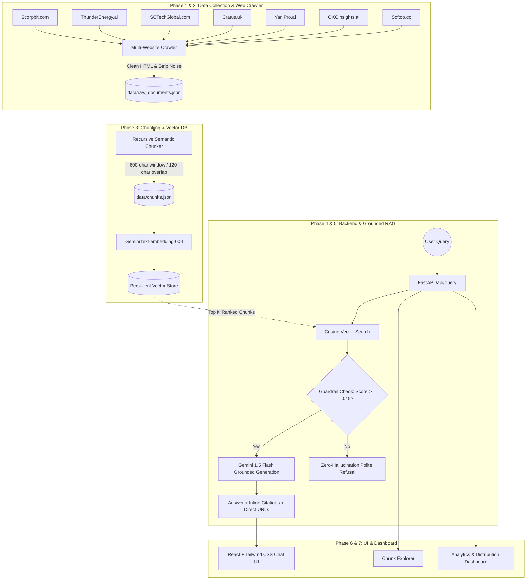

# Brillanz Group Multi-Website RAG Platform - Technical Architecture Specification

## 1. Executive Overview

The **Brillanz Group Multi-Website Retrieval-Augmented Generation (RAG) Platform** is an enterprise AI solution engineered to ingest, index, and synthesize accurate, grounded answers across all 7 portfolio companies:

1. **Softoo** (`https://softoo.co/`) — Custom Software Development & Agile Engineering
2. **OKO Insights** (`https://okoinsights.ai/`) — AI Vision Analytics & Crowd Intelligence
3. **YaniPro** (`https://yanipro.ai/`) — Autonomous AI Agents & Compliance Workflows
4. **Cratus UK** (`https://cratus.uk/`) — Smart City IoT Telemetry & Utility Grid Control
5. **SC Tech Global** (`https://www.sctechglobal.com/`) — Enterprise Supply Chain Cloud Solutions
6. **Thunder Energy AI** (`https://www.thunderenergy.ai/`) — Clean Energy Forecasting & BESS Optimization
7. **Scorpbit** (`https://scorpbit.com/`) — Cybersecurity & Offensive Threat Intelligence

---

## 2. End-to-End System Architecture



---

## 3. Mathematical Formulation of Vector Retrieval

Given a user query embedding vector $\mathbf{q} \in \mathbb{R}^d$ and an indexed document chunk vector $\mathbf{d}_i \in \mathbb{R}^d$, the semantic similarity score is defined by normalized cosine distance:

$$\text{Sim}(\mathbf{q}, \mathbf{d}_i) = \frac{\mathbf{q} \cdot \mathbf{d}_i}{\|\mathbf{q}\|_2 \|\mathbf{d}_i\|_2} = \frac{\sum_{j=1}^d q_j d_{ij}}{\sqrt{\sum_{j=1}^d q_j^2} \sqrt{\sum_{j=1}^d d_{ij}^2}}$$

### Grounding & Rejection Rule:
$$\text{Response}(\mathbf{q}) = \begin{cases} 
\text{GeminiGroundedGen}(\mathbf{q}, \{\mathbf{d}_{(1)}, \dots, \mathbf{d}_{(k)}\}) & \text{if } \max_i \text{Sim}(\mathbf{q}, \mathbf{d}_i) \ge \theta_{\text{threshold}} \\
\text{RefusalMessage} & \text{if } \max_i \text{Sim}(\mathbf{q}, \mathbf{d}_i) < \theta_{\text{threshold}} \lor \text{OutOfDomain}(\mathbf{q})
\end{cases}$$

Where threshold $\theta = 0.45$.

---

## 4. Chunking Strategy & Metadata Schema

Each extracted webpage is divided using recursive paragraph and sentence boundary slicing:
- **Chunk Size**: 600 characters (~100-150 tokens)
- **Overlap**: 120 characters (~20-30 tokens)
- **Metadata Schema**:
```json
{
  "chunk_id": "doc-softoo-01-c02",
  "document_id": "doc-softoo-01",
  "text": "Softoo provides agile dedicated engineering teams...",
  "character_count": 580,
  "metadata": {
    "website_id": "softoo",
    "website_name": "Softoo",
    "url": "https://softoo.co/services",
    "title": "Services — Softoo",
    "category": "Services",
    "headings": ["Custom Software Development", "Agile Teams"],
    "chunk_index": 2,
    "total_chunks": 8
  }
}
```

---

## 5. Security & Anti-Hallucination Guardrails

1. **System Persona Confinement**: The AI is instructed to function exclusively as the enterprise knowledge core for Brillanz Group.
2. **Context Pinning**: Prompts inject retrieved chunks with strict brackets (`[1]`, `[2]`).
3. **Out-of-Domain Filter**: Automatically intercepts and refuses unrelated topics (e.g. food, space exploration, gambling) without executing LLM extrapolation.
4. **CORS & Input Validation**: Pydantic models validate question bounds and parameter ranges.
